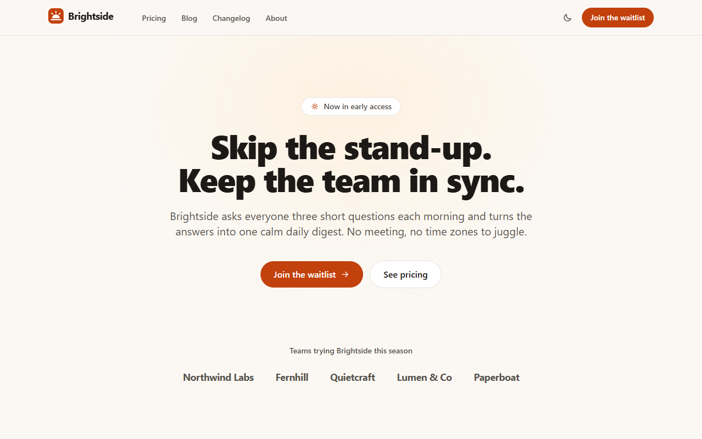

# Astro Website Starter

> **Free CodePlate template, v1.0.3.** This repository mirrors the zip on [codeplate.io](https://codeplate.io/t/site-starter/).
> Press **Use this template** to start your own repository from it, or [download the zip](https://codeplate.io/t/site-starter/).
> [All templates](https://codeplate.io/) · [Free License](https://codeplate.io/license/free/) · subscribers get it under the [Pro License](https://codeplate.io/license/pro/) with no credit.



A fast, finished website for **Astro 7**, built so your AI agent can turn it into *your* site: a product, a small business, a studio or a personal page.

## What's inside

- **Pages:** a home page with hero, features, screenshot, testimonials, pricing teaser, FAQ and waitlist form; pricing; a blog with tags, RSS and reading time; a changelog; about, contact, privacy and terms; a thank-you page and a 404 page.
- **Content in plain files:** blog posts in Markdown or MDX, authors, changelog entries and text pages are content collections with schemas, so a missing title or alt text fails the build instead of shipping. The home page words, plans and navigation live in small data files.
- **SEO:** titles, descriptions, canonical URLs, Open Graph and Twitter cards, JSON-LD for posts, a sitemap, robots.txt and a share image.
- **Light and dark theme** following the system, with a toggle that's remembered and doesn't flash. Accessible: skip link, focus styles, alt text required, contrast tested.
- **A working form** for the waitlist and contact page, with no account needed: submissions print in development and go to a webhook (Slack, Discord, Zapier…) in production. Recipes add Resend email and Buttondown.
- **Static HTML** for every page, plus one small server route for the form. Deploys to Cloudflare, Vercel, Netlify or any Node host; or drop the form server and host it anywhere.
- **For your agent:**
  - a brief (`AGENTS.md`) and 11 step-by-step recipes
  - one check command: env docs, types and content schemas, unit tests, build, a link checker for the built site, and browser tests of every page and the forms
  - a screenshot tool, so it can see its work in light, dark and phone sizes

## Use it with your agent

1. Unzip this folder where you want your project to live.
2. Install [Node.js](https://nodejs.org) 22.12 or newer (24 recommended).
3. Open the folder with your agent (Claude Code or similar) and say something like:

> This is a website starter from CodePlate. Read AGENTS.md, then let's build my bakery's website: "Crumb & Co", with our menu, opening hours and a newsletter sign-up.

The agent will ask you a few questions, record your decisions in `docs/project.md`, and change the site step by step, running the checks after each change.

## Run it yourself

```
npm install
npm run dev          # http://localhost:4321
npm run setup        # once: the browser for the screen tests
npm run check        # everything; ends with CODEPLATE CHECKS: PASS
npm run shots -- / blog --dark   # screenshots in shots/
```

## License

You can use, modify and ship sites made from this template, including commercially. Sites you publish must show the credit "Built with CodePlate (codeplate.io)": the template already puts it in the footer. You can't resell the template itself. See LICENSE.md. The npm packages it installs keep their own open-source licenses, almost all MIT or Apache-2.0. Astro's image pipeline uses sharp, whose libvips is LGPL-3.0, and Tailwind uses lightningcss (MPL-2.0); both run only when the site builds, and are fine to use in closed-source projects as long as you don't modify them. The pictures in the template (logo, screenshot, blog covers, share image) were drawn for it and are yours to use or replace.

Made by [CodePlate](https://codeplate.io).
